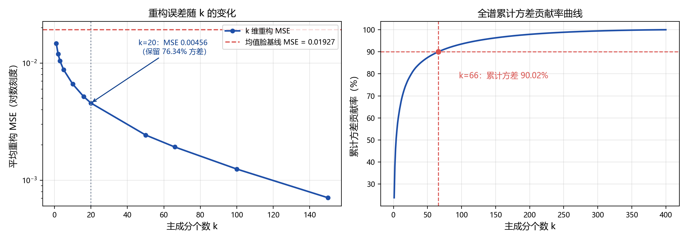
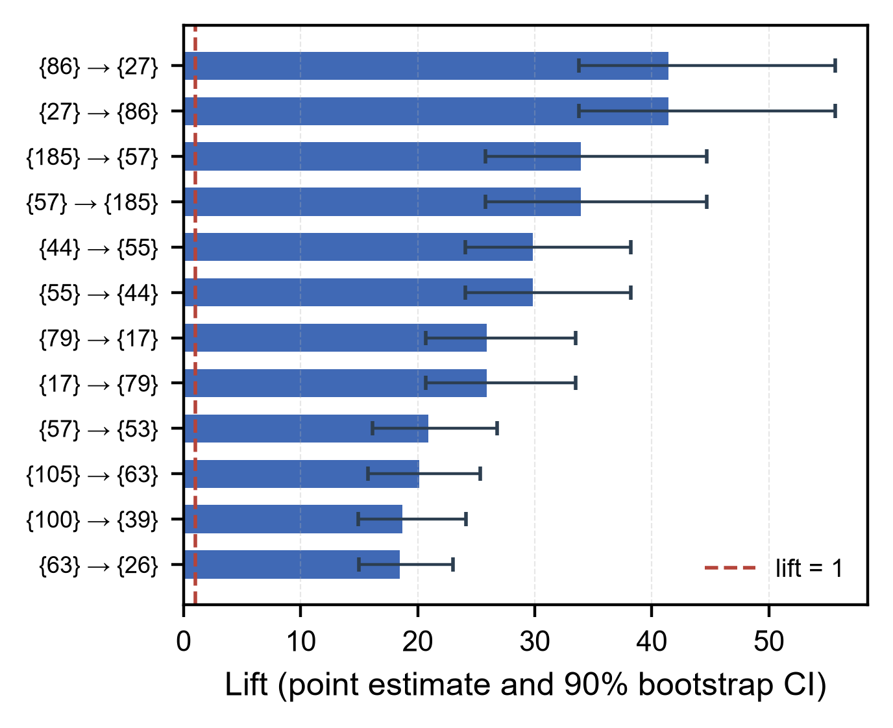

# bigdata-labs · 大数据分析与处理实验

《大数据分析与处理》课程实验代码与论文源码合集：**PCA 人脸重建**与**关联规则挖掘（Apriori / FP-growth）**。每个实验都包含从零实现的算法、定量评估脚本、可复现的结果数据，以及可一键编译的 IEEE 格式论文源码。

> Two course projects for *Big Data Analysis and Processing*: (1) PCA-based face reconstruction on Olivetti faces, (2) Apriori and FP-growth frequent-itemset mining on sparse transaction data. Each lab ships pure NumPy implementations, quantitative evaluation scripts, recorded result CSV/figures, and an IEEE-format paper source that compiles with one command. Docs are in Chinese; code, figures and paper sources are English- or Chinese-labelled as noted per lab.

[](LICENSE)
[](requirements.txt)

---

## 实验一览

| 实验 | 主题 | 核心方法 | 关键产出 |
|---|---|---|---|
| [实验一](lab1-pca-face-reconstruction/) | 使用 PCA 实现人脸重建 | 自实现 PCA（SVD / 协方差+特征分解双路径）、特征脸、k 扫描评估 | 9 张结果图、`metrics_table.csv`、5 页 IEEE 论文 |
| [实验二](lab2-association-rules/) | 关联规则挖掘 | 自实现 Apriori 与 FP-growth、剪枝代价分析、bootstrap 规则稳健性 | 8 张结果图、20+ CSV、3 页 IEEE 论文 |

两个实验的共同取向：**不用现成算法库**（不调 `mlxtend` / `sklearn.decomposition`），核心逻辑全部自己实现；再用手写实现与独立口径互证（SVD 对协方差分解、FP-growth 对 Apriori），确保结果不是"库的黑盒"。

---

## 目录结构

```
bigdata-labs/
├── lab1-pca-face-reconstruction/
│   ├── pca_face_reconstruction.py        # 中文版：7 步实验 + 10 项扩展分析
│   ├── pca_face_reconstruction_en.py     # 英文版：同一流水线，英文图表标签
│   ├── data/olivetti_py3.pkz             # Olivetti faces 缓存（离线可用）
│   ├── results/                          # 9 张结果图 + metrics_table.csv + 控制台日志
│   ├── results_en/                       # 英文版控制台日志（论文数字复核用）
│   └── paper/                            # IEEEtran 源码 + 矢量图 + 构建脚本
└── lab2-association-rules/
    ├── code/
    │   ├── apriori.py                    # Apriori：候选生成 + 两种计数策略
    │   ├── fp_growth.py                  # FP-growth：FP-tree 构建 + 条件模式基递归
    │   ├── run_experiments.py            # 参数网格主实验（生成 results/）
    │   ├── analyze_rule_robustness.py    # bootstrap 重采样评估规则稳定性
    │   └── test_apriori.py / test_fp_growth.py   # 23 个用例，含暴力全枚举对拍
    ├── data/array_data.csv               # 1892 条事务、1990 个不同 item
    ├── results/                          # 全部 CSV 与图表
    └── paper/                            # IEEEtran 源码 + 表格/图生成脚本
```

---

## 快速开始

```bash
git clone https://github.com/cwxa/bigdata-labs.git
cd bigdata-labs
pip install -r requirements.txt
```

**实验一（PCA 人脸重建）**

```bash
cd lab1-pca-face-reconstruction
python pca_face_reconstruction.py     # 约 40 s，重写 results/ 下全部产物
```

数据集已随仓库提供缓存（`data/olivetti_py3.pkz`），`fetch_olivetti_faces` 命中缓存后直接离线加载，不会联网下载。

**实验二（关联规则）**

```bash
cd lab2-association-rules/code
python -m unittest test_apriori test_fp_growth -v   # 23 个用例，约 1 s
python run_experiments.py                           # 参数网格，约 10 s
python analyze_rule_robustness.py                   # bootstrap 200 次，约 20 s
```

脚本内的所有数据与产物路径都由 `__file__` 解析，从任意工作目录调用都能正确命中仓库内文件。

---

## 结果速览

### 实验一：k=20 时保留了 76.34% 方差

| k | MSE | PSNR (dB) | 累计方差 | SSIM | 1-NN 识别率 |
|---:|---:|---:|---:|---:|---:|
| 0（均值脸） | 0.01927 | 17.52 | 0.00% | — | — |
| 5 | 0.00879 | 20.80 | 54.38% | 0.540 | 76.0% |
| **20** | **0.00456** | **23.64** | **76.34%** | **0.698** | **94.8%** |
| 50 | 0.00243 | 26.36 | 87.38% | 0.812 | 95.5% |
| 150 | 0.00071 | 31.58 | 96.32% | — | 95.5% |

三条可验证的结论：

1. **理论口径自洽**：用特征值之和预测 `MSE(k=20) = 0.004571`，与实测 `0.004559` 相对偏差仅 **0.25%**，说明 PCA 重构误差的理论与实现没有脱节。
2. **两条求解路径等价**：SVD 与「协方差 + `eigh`」的 k=20 重构最大绝对差为 `1.97e-07`，属于浮点噪声量级；耗时比为 **3.08 s : 13.37 s（约 4.3 倍）**——4096 维下用 SVD 不必显式构造 4096×4096 协方差矩阵，这是实测而非教科书结论。
3. **降维确实提升了可分性**：类内/类间平均距离比从像素空间的 0.675 降到 20 维 PCA 空间的 0.562，与 1-NN 识别率从 76% 涨到 94.8% 相互印证。



### 实验二：支持度越低，FP-growth 的相对优势越大

数据：1892 条事务、1990 个不同 item、平均长度 11.79、最长 86——典型的**稀疏长事务**场景，正是 Apriori 候选爆炸的温床。

| min_sup | 频繁项集 | 最大阶数 | Apriori (s) | FP-growth (s) | 加速比 |
|---:|---:|---:|---:|---:|---:|
| 2% | 96 | 2 | 0.0219 | 0.0140 | 1.57× |
| 1% | 335 | 3 | 0.0981 | 0.0349 | 2.81× |
| 0.5% | 1115 | 4 | 0.5087 | 0.0968 | 5.26× |
| 0.2% | 6524 | 7 | 3.9990 | 0.2299 | **17.4×** |

配套的剪枝数据说明了原因：min_sup=0.2% 时第 2 层候选高达 **1,149,886** 个，最终只有 3356 个频繁——候选与结果的比值约 343:1，Apriori 的绝大部分时间花在给注定被剪掉的候选项集计数。

**关于 lift 的诚实说明**：min_sup=0.5% 时出现了 lift 高达 50 的规则，但它们的绝对支持计数只有个位数到二十几，lift 本质是小样本比值，点估计极不稳定。对 1892 条事务做 **200 次 bootstrap 重采样**后，min_sup=1% 的 49 条规则中只有 **27 条**（55%）的置信度 90% 区间下界仍不低于阈值。所以论文里不把全部高 lift 规则当作"强关联"结论——这是本项目与常见作业最大的方法论差异。



---

## 论文构建

两个 `paper/` 目录都提供一键构建脚本，除编译外还带交付守卫（缺字、超宽浮动体、浮动体跑到参考文献之后、孤立 `\label`、PDF 反向文本校验）：

```bash
# 需要 Tectonic；脚本优先读环境变量 TECTONIC，其次查 PATH
export TECTONIC=/path/to/tectonic        # Windows: set TECTONIC=E:\tools\tectonic\tectonic.exe

cd lab1-pca-face-reconstruction/paper && python build.py   # → main.pdf（5 页）
cd lab2-association-rules/paper      && python build.py    # → main.pdf（3 页）
```

实验二的 `build.py` 会先重跑 `make_numbers.py` / `make_tables.py`，从 `results/*.csv` 重新生成 110 个数字宏和两张表格，因此**论文里的数字永远与 CSV 同源**，不存在手抄误差。

未安装 Tectonic 时可改用本地 TeX Live：`cd paper && xelatex main.tex`（重复两次以解析交叉引用）。

---

## 数据来源与合规

| 数据 | 来源 | 说明 |
|---|---|---|
| Olivetti faces | [AT&T / sklearn `fetch_olivetti_faces`](https://scikit-learn.org/stable/modules/generated/sklearn.datasets.fetch_olivetti_faces.html) | 公开学术数据集，400 张 64×64 灰度人脸，40 人×10 张 |
| `array_data.csv` | 课程实验指导书附带 | 1892 条脱敏事务 ID 序列，无个人身份信息 |

代码以 MIT 许可开源。论文正文与图表由本仓库作者撰写/绘制；第三方数据集与课程提供的原始数据不适用 MIT 条款，遵循其原始许可。

---

## English Overview

Two self-contained lab projects for a Big Data course, each with from-scratch implementations, reproducible result data and an IEEE-format paper source.

**Lab 1 — PCA face reconstruction.** A hand-written PCA (`numpy.linalg.svd` and a covariance + `eigh` variant), eigenface visualisation, and a 12-point k-sweep evaluation (MSE / PSNR / SSIM / 1-NN accuracy / identity separability). At k=20 the reconstruction retains 76.34% of total variance; the observed MSE agrees with the eigenvalue-based prediction to within 0.25%, and the two solver paths differ by `1.97e-07`.

**Lab 2 — Association rule mining.** Hand-written Apriori (with two support-counting strategies and a pruning-cost analysis) and FP-growth verified against Apriori item by item. On 1892 sparse transactions, FP-growth is 1.57× faster than Apriori at 2% minimum support and 17.4× faster at 0.2%. Rule stability is assessed with 200-round bootstrap resampling: at 1% support only 27 of 49 rules keep their 90% confidence lower bound above the threshold, so high-lift rules are not reported as strong associations without that caveat.

Run `pip install -r requirements.txt`, then `python pca_face_reconstruction.py` or `python -m unittest test_apriori test_fp_growth`. Papers build with `python build.py` inside each `paper/` directory (requires Tectonic). Licensed MIT.
